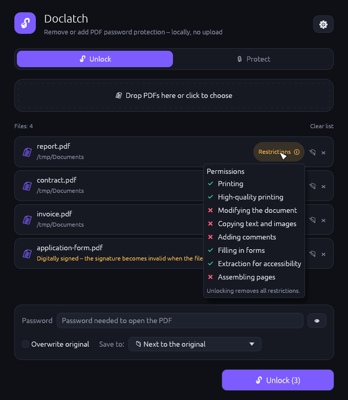
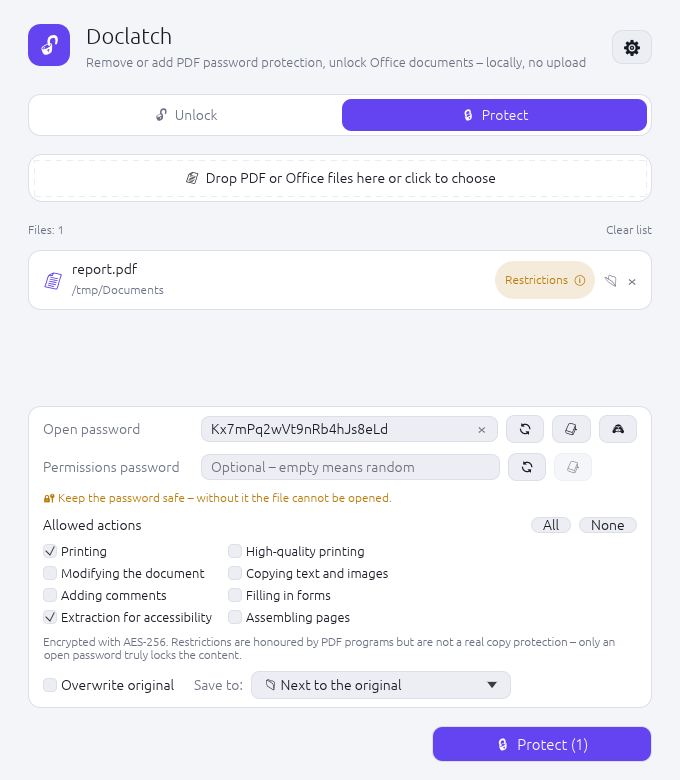
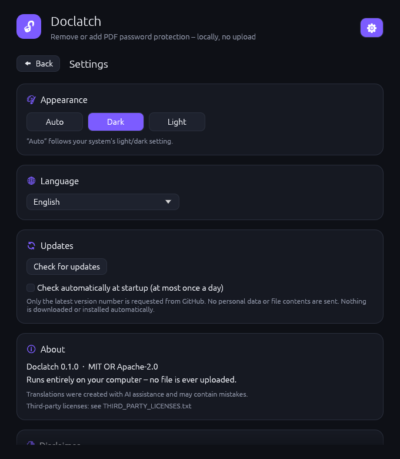

# Doclatch

[English](README.md) · **Deutsch**

<p align="center">
  
  
  
</p>

Die Screenshots zeigen die englische Oberfläche; die Sprache lässt sich in den Einstellungen umstellen.

Entfernt Passwortschutz und Rechte-Einschränkungen (Drucken, Kopieren, Bearbeiten) aus PDF-Dateien –
oder schützt PDFs mit AES-256, Öffnen-Passwort und gezielten Einschränkungen.
Reines Rust, läuft nativ auf Linux, Windows und macOS. Dateien werden lokal verarbeitet und nie hochgeladen.

> Zum Entfernen eines **Öffnen-Passworts** muss das Passwort bekannt sein (Benutzer- oder Besitzer-Passwort).
> Reine Einschränkungen (PDF öffnet sich ohne Passwort) werden ohne Eingabe entfernt.

Unterstützt: RC4 40/128 Bit, AES-128, AES-256 (Standard-Security-Handler, PDF 1.4 – 2.0).

**Office-Dokumente:** Bearbeitungs-, Blatt- und Strukturschutz wird aus Word-, Excel- und
PowerPoint-Dateien (`.docx`, `.xlsx`, `.pptx` samt Makro- und Vorlagenvarianten) sowie aus
OpenDocument-Dateien (`.odt`, `.ods`, `.odp`, `.odg` und Vorlagen) entfernt:
eingeschränkte Bearbeitung, Blatt- und Arbeitsmappenschutz, geschützte Bereiche,
geschützte Änderungsverfolgung, „Kennwort zum Ändern“ und die Empfehlung, schreibgeschützt zu öffnen.
Dieser Schutz ist keine Verschlüsselung, daher ist kein Passwort nötig; entfernt werden nur die
Schutz-Einträge, alle übrigen Teile der Datei bleiben byte-genau erhalten. Mit Passwort verschlüsselte
Office-Dateien werden erkannt, aber noch nicht entschlüsselt. Schützen ist nur für PDF-Dateien verfügbar.

Oberfläche in 11 Sprachen (Englisch als Standard, Deutsch, Französisch, Spanisch, Italienisch, Portugiesisch,
Niederländisch, Polnisch, Türkisch, Russisch, Ukrainisch), Theme Auto/Dunkel/Hell. Die Übersetzungen
wurden mit KI-Unterstützung erstellt; Korrekturen von Muttersprachlern sind willkommen (`src/i18n.rs`).

## Benutzung

**Oberfläche:** `doclatch` starten, PDFs ins Fenster ziehen oder auf das Feld klicken und auf „Entsperren“ klicken.
Das Passwortfeld erscheint nur, wenn eine Datei wirklich ein Öffnen-Passwort braucht.
Mit der Maus über dem Status „Einschränkungen“ bzw. „Passwort“ werden die einzelnen Berechtigungen angezeigt.
Digital signierte PDFs werden gekennzeichnet: Entsperren oder Schützen verändert die Datei, dadurch wird die Signatur ungültig.
Der Knopf 📂 zeigt die Datei (bzw. ihr Ergebnis) markiert im Dateimanager.
Ergebnis: `name_unlocked.pdf` neben dem Original, in einem gewählten Ordner oder (optional) als Ersatz für das Original.

**Schützen** (Umschalter „🔒 Schützen“): optionales Öffnen-Passwort, optionales Rechte-Passwort
(leer = zufällig) und die erlaubten Aktionen wählen. Ergebnis: `name_protected.pdf`.
🔄 erzeugt ein zufälliges Passwort (20 Zeichen ohne verwechselbare wie `0/O` oder `l/1/I`), 📑 kopiert es.
Nach dem Schützen speichert „💾 Passwörter speichern…“ eine Liste der Ergebnisdateien samt Passwörtern –
als lesbaren Text (`.txt`) oder als CSV zum Import in Passwortmanager wie KeePassXC oder Bitwarden (`.csv`).
Die Liste ist nicht verschlüsselt; unter Linux und macOS ist sie nur für den Besitzer lesbar.
Ein zufälliges Rechte-Passwort wird nie gespeichert.
Verschlüsselt wird mit AES-256 (PDF 2.0, Revision 6). Hinweis: Rechte-Einschränkungen werden von PDF-Programmen
nur freiwillig beachtet und sind kein echter Kopierschutz – nur ein Öffnen-Passwort sperrt den Inhalt wirklich.

**Einstellungen** (⚙ oben rechts): Theme Auto/Dunkel/Hell und Sprache. „Auto“ folgt dem System
(Linux: über das XDG-Desktop-Portal). Gespeichert in `settings.txt` unter
`~/.config/doclatch/` (Linux), `~/Library/Application Support/doclatch/` (macOS) bzw. `%APPDATA%\doclatch\` (Windows).

**Kommandozeile** (durchgehend englisch):

```bash
doclatch -p geheim vertrag.pdf             # → vertrag_unlocked.pdf
doclatch --info vertrag.pdf                # nur Schutz und Berechtigungen anzeigen
doclatch *.pdf -o ./entsperrt/             # mehrere Dateien, Zielordner
doclatch --in-place rechnung.pdf           # Original überschreiben
DOCLATCH_PASSWORD=geheim doclatch a.pdf    # Passwort ohne Shell-History
doclatch --gui a.pdf b.pdf                 # Oberfläche mit vorausgewählten Dateien
doclatch bericht.xlsx brief.odt            # → bericht_unlocked.xlsx, brief_unlocked.odt
doclatch --protect --open-password geheim --allow print vertrag.pdf   # → vertrag_protected.pdf
doclatch --protect --allow print,copy *.pdf                           # nur Einschränkungen
```

`doclatch --help` zeigt alle Optionen.

**Updates:** Einstellungen → Updates → „Nach Updates suchen“ fragt bei GitHub die neueste Versionsnummer ab.
Dort lässt sich auch eine automatische Prüfung beim Start einschalten (höchstens einmal täglich); sie ist
standardmäßig aus. Abgefragt wird nur die Versionsnummer, nichts wird heruntergeladen oder installiert, und
es werden keine persönlichen Daten oder Dateiinhalte gesendet. Nur dabei verbindet sich die App mit
dem Internet. Für die Abfrage dient `curl`, das in gängigen Linux-Distributionen, macOS und Windows 10/11
enthalten ist.

## Download

Fertige Pakete gibt es auf der Release-Seite:

| Plattform | Architekturen | Format |
|---|---|---|
| Linux | x86-64, ARM64, RISC-V (glibc ≥ 2.28) | `.tar.gz`, `.deb` |
| Windows | x86-64, ARM64 | `.zip` |
| macOS | Universal (Apple Silicon + Intel), ab macOS 11 | `.app` in `.zip` |

Die Linux-Pakete laufen auf Debian 10, Ubuntu 18.10, RHEL/Alma/Rocky 8, Fedora 29 und neuer.

Die macOS-App ist nur ad-hoc signiert (kein Apple-Entwicklerkonto): beim ersten Start
Rechtsklick → „Öffnen“. Windows-Builds sind unsigniert (SmartScreen-Hinweis möglich).

## Bauen

```bash
cargo build --release
# Ergebnis: target/release/doclatch   (Windows: doclatch.exe)
```

Zum Bauen sind auf keiner Plattform zusätzliche Systempakete nötig.
Zur Laufzeit braucht Linux X11 oder XWayland; der Dateidialog nutzt das XDG-Desktop-Portal (`xdg-desktop-portal`).

Optionale Features:

- `--features wayland`: natives Wayland statt XWayland (nur für Systeme ohne XWayland;
  **dann funktioniert Drag & Drop nicht**, weil winit 0.30 es unter Wayland nicht unterstützt)
- `--features accessibility`: Screenreader-Unterstützung (AccessKit)

Unter Linux läuft die App standardmäßig über X11/XWayland. Das ist nötig für Drag & Drop.

### Linux-Integration („Öffnen mit …“)

```bash
install -Dm755 target/release/doclatch ~/.local/bin/doclatch
install -Dm644 packaging/doclatch.desktop ~/.local/share/applications/doclatch.desktop
```

### Release-Pakete

**Lokal: Linux für alle Architekturen (cargo-zigbuild)**

```bash
cargo install --locked cargo-zigbuild cargo-deb      # Zig: pip install ziglang (oder Paketmanager)
rustup target add aarch64-unknown-linux-gnu riscv64gc-unknown-linux-gnu
scripts/build-linux.sh                               # → dist/
```

Ergebnis: `.tar.gz` und `.deb` für x86-64, ARM64 und RISC-V, plus `SHA256SUMS.txt`.

**GitHub: alle Plattformen**

| Workflow | Auslöser | Ergebnis |
|---|---|---|
| `.github/workflows/ci.yml` | Push auf `main`, Pull Requests | Tests, Clippy und Formatprüfung auf Linux, Windows, macOS |
| `.github/workflows/release.yml` | Tag `v*` (z. B. `git tag v0.1.0 && git push origin v0.1.0`) | Release-**Entwurf** mit allen Paketen |

## Tests

```bash
cargo test
```

## Entstehung

Doclatch wurde mit KI-Unterstützung (Claude von Anthropic) entwickelt, ebenso die Übersetzungen.
Der Code ist durch automatische Tests abgedeckt (`cargo test`); Fehlermeldungen und Verbesserungen sind willkommen.

## Lizenz

Doclatch steht wahlweise unter der [MIT-Lizenz](LICENSE-MIT) oder der
[Apache-Lizenz 2.0](LICENSE-APACHE) – wer das Programm nutzt oder weitergibt, sucht sich eine davon aus.

Beiträge (z. B. Übersetzungskorrekturen) werden, sofern nicht ausdrücklich anders angegeben,
unter denselben beiden Lizenzen eingebracht.

### Lizenzen der Abhängigkeiten

`THIRD_PARTY_LICENSES.md` (Übersicht) und `THIRD_PARTY_LICENSES.txt` (Volltexte, bei Weitergabe beilegen).
Nach Abhängigkeits-Updates neu erzeugen: `python3 scripts/gen_licenses.py`

## Haftungsausschluss

Diese Software wird „wie sie ist“ bereitgestellt, ohne jegliche Gewährleistung. Die Nutzung erfolgt auf
eigene Verantwortung – bitte von wichtigen Dateien Sicherungen behalten. Nur Dokumente bearbeiten, zu deren
Bearbeitung man berechtigt ist.
