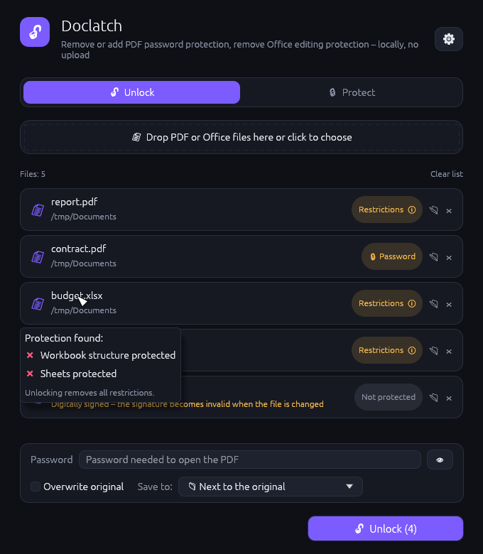
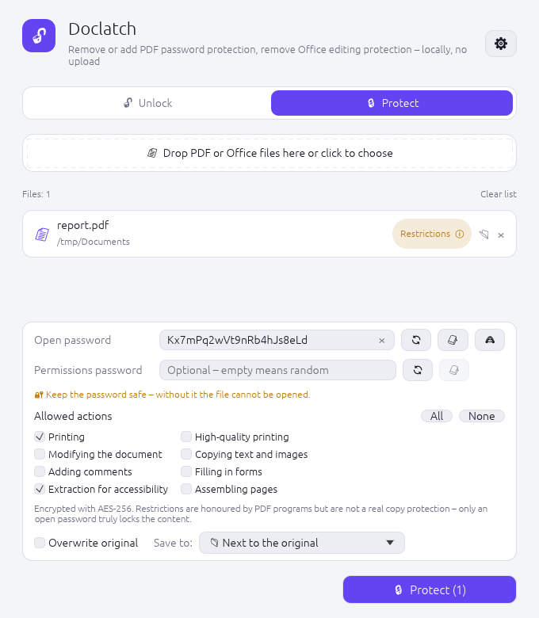
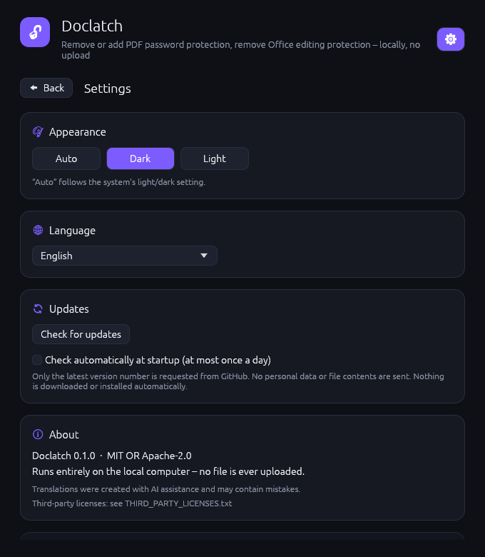

# Doclatch

**English** · [Deutsch](README.de.md)

<p align="center">
  
  
  
</p>

Removes password protection and permission restrictions (printing, copying, editing) from PDF files –
or protects PDFs with AES-256, an open password and selected restrictions.
Pure Rust, runs natively on Linux, Windows and macOS. Files are processed locally and never uploaded.

> To remove an **open password**, the password must be known (user or owner password).
> Pure restrictions (the PDF opens without a password) are removed without any input.

Supported: RC4 40/128-bit, AES-128, AES-256 (standard security handler, PDF 1.4 – 2.0).

**Office documents:** editing, sheet and structure protection is removed from
Word, Excel and PowerPoint files (`.docx`, `.xlsx`, `.pptx` including macro and template variants)
and from OpenDocument files (`.odt`, `.ods`, `.odp`, `.odg` and templates):
editing restrictions, sheet and workbook structure protection, protected sections,
protected change tracking, “password to modify” and the read-only recommendation.
This protection is not encryption, so no password is needed; only the protection entries are removed,
all other parts of the file stay byte-for-byte unchanged. Password-encrypted Office files are
recognised but not decrypted yet. Protecting is available for PDF files only.

User interface in 11 languages (English by default, German, French, Spanish, Italian, Portuguese,
Dutch, Polish, Turkish, Russian, Ukrainian), theme Auto/Dark/Light. The translations were created
with AI assistance; corrections by native speakers are welcome (`src/i18n.rs`).

## Usage

**GUI:** start `doclatch`, drop PDFs into the window or click the drop area, then click “Unlock”.
The password field only appears when a file actually needs an open password.
Hover over the “Restrictions” or “Password” badge to see the individual permissions.
Digitally signed PDFs are marked: unlocking or protecting changes the file, which invalidates the signature.
The 📂 button shows the file (or its result) selected in the file manager.
Result: `name_unlocked.pdf` next to the original, in a chosen folder, or (optionally) replacing the original.

**Protect** (switch “🔒 Protect”): choose an optional open password, an optional permissions password
(empty = random) and the allowed actions. Result: `name_protected.pdf`.
🔄 generates a random password (22 characters without easily confused ones such as `0/O` or `l/1/I`),
📑 copies it. After protecting, “💾 Save passwords…” stores a list of the result files with their
passwords – as readable text (`.txt`) or as CSV for importing into password managers such as
KeePassXC or Bitwarden (`.csv`). The list is not encrypted; on Linux and macOS it is readable
only by the owner. A random permissions password is never stored.
Encryption is AES-256 (PDF 2.0, revision 6). Note: permission restrictions are only honoured voluntarily
by PDF programs and are not a real copy protection – only an open password truly locks the content.

**Settings** (⚙ top right): theme Auto/Dark/Light and language. “Auto” follows the system
(Linux: via the XDG desktop portal). Stored in `settings.txt` under
`~/.config/doclatch/` (Linux), `~/Library/Application Support/doclatch/` (macOS) or `%APPDATA%\doclatch\` (Windows).

**Command line:**

```bash
doclatch -p secret contract.pdf            # → contract_unlocked.pdf
doclatch --info contract.pdf               # only show protection and permissions
doclatch *.pdf -o ./unlocked/              # several files, output folder
doclatch --in-place invoice.pdf            # overwrite the original
DOCLATCH_PASSWORD=secret doclatch a.pdf    # password without shell history
doclatch --gui a.pdf b.pdf                 # GUI with preselected files
doclatch report.xlsx letter.odt            # → report_unlocked.xlsx, letter_unlocked.odt
doclatch --protect --open-password secret --allow print contract.pdf   # → contract_protected.pdf
doclatch --protect --allow print,copy *.pdf                            # restrictions only
```

`doclatch --help` lists all options.

**Updates:** Settings → Updates → “Check for updates” asks GitHub for the latest version number.
An automatic check at startup (at most once a day) can be switched on there; it is off by default.
Only the version number is requested, nothing is downloaded or installed, and no personal data or
file contents are sent. This is the only time the app connects to the internet.
The check uses `curl`, which is included in common Linux distributions, macOS and Windows 10/11.

## Download

Ready-made packages are available on the releases page:

| Platform | Architectures | Format |
|---|---|---|
| Linux | x86-64, ARM64, RISC-V (glibc ≥ 2.28) | `.tar.gz`, `.deb` |
| Windows | x86-64, ARM64 | `.zip` |
| macOS | Universal (Apple Silicon + Intel), macOS 11 or later | `.app` in `.zip` |

Linux packages run on Debian 10, Ubuntu 18.10, RHEL/Alma/Rocky 8, Fedora 29 and newer.

The macOS app is only ad-hoc signed (no Apple developer account): on first launch,
right-click → “Open”. Windows builds are unsigned (a SmartScreen warning may appear).

## Building

```bash
cargo build --release
# Result: target/release/doclatch   (Windows: doclatch.exe)
```

No additional system packages are required for building, on any platform.
At runtime, Linux needs X11 or XWayland; the file dialog uses the XDG desktop portal (`xdg-desktop-portal`).

Optional features:

- `--features wayland`: native Wayland instead of XWayland (only for systems without XWayland;
  **drag & drop does not work then**, because winit 0.30 does not support it on Wayland)
- `--features accessibility`: screen reader support (AccessKit)

On Linux the app uses X11/XWayland by default. This is required for drag & drop.

### Linux integration (“Open with …”)

```bash
install -Dm755 target/release/doclatch ~/.local/bin/doclatch
install -Dm644 packaging/doclatch.desktop ~/.local/share/applications/doclatch.desktop
```

### Release packages

**Locally: Linux for all architectures (cargo-zigbuild)**

```bash
cargo install --locked cargo-zigbuild cargo-deb      # Zig: pip install ziglang (or the system package manager)
rustup target add aarch64-unknown-linux-gnu riscv64gc-unknown-linux-gnu
scripts/build-linux.sh                               # → dist/
```

Result: `.tar.gz` and `.deb` for x86-64, ARM64 and RISC-V, plus `SHA256SUMS.txt`.

**GitHub: all platforms**

| Workflow | Trigger | Result |
|---|---|---|
| `.github/workflows/ci.yml` | push to `main`, pull requests | tests, Clippy and formatting check on Linux, Windows, macOS |
| `.github/workflows/release.yml` | tag `v*` (e.g. `git tag v0.1.0 && git push origin v0.1.0`) | release **draft** with all packages |

## Tests

```bash
cargo test
```

## Origin

Doclatch was developed with AI assistance (Claude by Anthropic), as were the translations.
The code is covered by automated tests (`cargo test`); bug reports and improvements are welcome.

## License

Doclatch is licensed under either the [MIT License](LICENSE-MIT) or the
[Apache License 2.0](LICENSE-APACHE), at your option.

Unless you explicitly state otherwise, any contribution (e.g. translation fixes) intentionally submitted
for inclusion in this project shall be dual-licensed as above, without any additional terms or conditions.

### Third-party licenses

`THIRD_PARTY_LICENSES.md` (overview) and `THIRD_PARTY_LICENSES.txt` (full texts, include when redistributing).
Regenerate after dependency updates: `python3 scripts/gen_licenses.py`

## Disclaimer

This software is provided “as is”, without warranty of any kind. Use is at one’s own risk; backups of
important files are recommended. Only documents one is entitled to edit should be processed.
